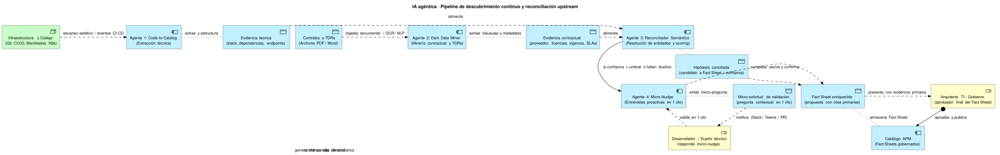

## De "bombero downstream" a motor de descubrimiento upstream

Tradicionalmente, la inteligencia artificial en la gestión de portafolio de aplicaciones se ha concebido como un consumidor pasivo o "bombero downstream": asume que el catálogo ya existe, está limpio y actualizado, limitándose a responder consultas de chat, correlacionar CVEs o calcular obsolescencia sobre datos preexistentes.

En organizaciones de alta complejidad y sector público, la realidad es que el catálogo manual falla por fatiga burocrática, falta de incentivos y dispersión de información. El verdadero cuello de botella es la captura y unificación de datos. La arquitectura del APM evoluciona hacia un **motor proactivo de descubrimiento continuo upstream**, donde un sistema multi-agente escanea activamente la realidad técnica y contractual para construir y mantener al día los Fact Sheets con mínima intervención humana.



---

## Topología del pipeline multi-agente de descubrimiento

El pipeline opera mediante cuatro agentes especializados que colaboran para pasar de datos crudos fragmentados a Fact Sheets gobernados y verificados:

```text
[ Fuentes Técnicas: Git / CI-CD / K8s ]       [ Dark Data: Contratos / TDRs (PDF/Word) ]
                 │                                                  │
                 ▼                                                  ▼
     ┌───────────────────────┐                          ┌───────────────────────┐
     │ Agente 1:             │                          │ Agente 2:             │
     │ Code-to-Catalog       │                          │ Dark Data Miner       │
     └───────────┬───────────┘                          └───────────┬───────────┘
                 │                                                  │
         [Evidencia Técnica]                            [Evidencia Contractual]
                 │                                                  │
                 └───────────────────┐      ┌───────────────────────┘
                                     ▼      ▼
                          ┌───────────────────────────┐
 [ Catálogo existente ]──►│ Agente 3:                 │
 [ Excel migrado + CMDB ] │ Reconciliador (ancla en   │
   (ancla de identidad)   │ catálogo, N:M)            │
                          └─────────────┬─────────────┘
                                        │
                       ¿Coincide con el catálogo?
                              ┌─────────┴─────────┐
                         Sí   │                   │   No
                              ▼                   ▼
                [Hipótesis conciliada     [Candidato huérfano:
                 N:M + score]              posible Shadow IT]
                              │                   │
                              │                   ▼
                              │           (Revisión humana)
                              │
               ¿Score < umbral o vacíos?
                        ┌─────┴─────┐
                   Sí   │           │   No (score ≥ umbral)
                        ▼           │
          ┌───────────────────┐     │
          │ Agente 4:         │     │
          │ Micro-Nudge       │     │
          └─────────┬─────────┘     │
                    │               │
           [Micro-solicitud]        │
                    ▼               │
          (Dueño técnico / Dev)     │
                    │ (1 clic)      │
                    └───────┬───────┘
                            ▼
              [Fact Sheet Enriquecido]
               (con citas primarias)
                            │
                            ▼
            (Arquitecto TI / Gobierno)
                            │ (Aprobación)
                            ▼
                   [Catálogo APM]
```

### Qué es determinista y qué usa LLM

El LLM se reserva para el texto no estructurado y la redacción; la extracción técnica, la vinculación y las decisiones son deterministas y reproducibles.

| Agente | Tipo de procesamiento | Uso de LLM |
|---|---|---|
| 1 · Code-to-Catalog | Parsers deterministas de manifiestos, dependencias y despliegues | No |
| 2 · Dark Data Miner | OCR + extracción guiada por esquema | Sí: extracción de campos desde texto libre, validada contra el esquema |
| 3 · Reconciliador | Reglas deterministas y *fuzzy matching* | Opcional: embeddings solo para casos ambiguos |
| 4 · Micro-Nudge | Lógica de decisión determinista (cuándo, a quién, qué preguntar) | Sí, solo para redactar la pregunta |

El modelo de lenguaje se consume detrás de una **capa de proveedor intercambiable**: el diseño no depende de un proveedor concreto (Google Gemini, OpenAI, Anthropic Claude o Azure OpenAI), y el proveedor se elige por entorno según costo y resultados de las evals (ver [Portabilidad y costo](../arquitectura-solucion/#portabilidad-y-costo)).

### Agente 1: Code-to-Catalog (Pilar técnico)

Este agente inspecciona de manera continua los artefactos generados en el ciclo de vida del desarrollo de software:
- **Fuentes analizadas**: Repositorios Git (GitHub/GitLab), Dockerfiles, manifiestos de Kubernetes, Helm charts, archivos de dependencias de empaquetado (`pom.xml`, `package.json`, `requirements.txt`, `go.mod`, `build.gradle`), y especificaciones OpenAPI/Swagger.
- **Capacidades de extracción**:
  - Identificación del stack tecnológico real y versiones de frameworks/runtimes en uso.
  - Mapeo de dependencias de librerías y componentes de infraestructura subyacente.
  - Detección de puertos, endpoints expuestos, variables de entorno y servicios de base de datos consumidos.
  - Detección de actividad reciente (commits, PRs) para **sugerir** un posible responsable técnico. Es solo una sugerencia que se confirma por micro-nudge: en el sector público el principal contribuyente suele ser el proveedor contratado, no el dueño institucional.
- **Resultado**: Genera un objeto estructurado de **Evidencia Técnica** con hashes de commit y rutas exactas de archivos como soporte.

### Agente 2: Dark Data Miner (Pilar contractual y documental)

Gran parte de la información crítica de una aplicación en organizaciones públicas o corporativas reside en lo que se denomina *Dark Data*: documentos no estructurados que nunca llegan al repositorio de código ni a la CMDB.
- **Fuentes analizadas**: Términos de Referencia (TDRs), contratos de desarrollo o mantenimiento, adendas, órdenes de compra y actas de conformidad técnica (archivos PDF, Word o digitalizaciones escaneadas).
- **Capacidades de extracción**:
  - Procesamiento multimodal (OCR para digitalizaciones y NLP / LLMs con extracción guiada por esquemas).
  - Extracción de proveedores adjudicados, razón social, consorcios y montos asociados.
  - Identificación de vigencia contractual, fechas límite de garantía, renovación y calendarios de soporte contratado.
  - Detección de Acuerdos de Nivel de Servicio (SLAs) contractuales (disponibilidad comprometida, tiempos de respuesta ante incidentes).
  - Identificación de licencias adquiridas y restricciones legales de uso.
- **Resultado**: Genera un objeto estructurado de **Evidencia Contractual y Licenciamiento**, indexando el documento de origen, número de página y cláusula contractual.

### Agente 3: Reconciliador Semántico (Entity Resolution)

El desafío principal en organizaciones reales es que el código y los contratos utilizan nomenclaturas diferentes: un repositorio puede llamarse `svc-pagos-v2`, mientras que el contrato lo denomina *"Servicio de Implementación de la Pasarela de Recaudación Digital para Entidades Públicas"*, y la CMDB lo etiqueta como `VM-PRD-PAGOS01`.

- **Ancla en el catálogo existente**: el reconciliador no construye entidades desde cero. Primero toma como referencia las aplicaciones ya conocidas (Excel migrado y CIs de la CMDB, ver [Gobierno y procedencia de datos](../gobierno-datos/#identidad-y-reconciliación-con-cmdb)) y luego **adjunta** a cada una la evidencia técnica del Agente 1 y la evidencia contractual del Agente 2.
- **Relación N:M, no 1:1**: una aplicación puede tener varios repositorios, varios contratos o TDRs (desarrollo, mantenimiento, adendas) y varios CIs; a la vez, un repositorio compartido o un contrato marco puede cubrir varias aplicaciones. El resultado es un grafo de vínculos, no un emparejamiento uno a uno.
- **Mecanismo de resolución**: reglas deterministas (claves externas, alias y códigos normalizados) y similitud léxica difusa (*fuzzy matching*) sobre nombres y descripciones; los embeddings semánticos son un complemento opcional para casos ambiguos.
- **Scoring de confianza multivariable**:
  - Calcula un *score* heurístico de confianza ($0.0$ a $1.0$) para cada atributo y para cada vínculo. **No es una probabilidad**: solo podrá interpretarse como tal tras calibrarlo contra un conjunto verificado de aplicaciones conocidas, midiendo precisión y exhaustividad (*precision/recall*).
  - Un **único umbral configurable** (p. ej. $0.85$, fijado tras la calibración) separa la publicación directa de la validación por micro-nudge.
  - Factores evaluados: concordancia de nombres/alias, congruencia tecnológica (si el TDR pedía Java/Spring y el repo contiene Java 17), alineación de fechas y coincidencia de equipos/autores.
- **Resultados posibles**:

  | Resultado | Significado | Siguiente paso |
  |---|---|---|
  | **Hipótesis conciliada** | La evidencia se vincula a una o más aplicaciones del catálogo (N:M) | Publicación directa o micro-nudge según el umbral |
  | **Candidato huérfano** | Sin coincidencia en el catálogo: repositorio, despliegue o contrato que no corresponde a ninguna aplicación conocida (posible Shadow IT) | Cola de revisión humana: el arquitecto decide si es una aplicación nueva, un componente de otra o un descarte |
  | **Conflicto** | La evidencia coincide con más de una aplicación sin poder discriminar | Cola de revisión humana, igual que los conflictos de la CMDB |

  "Sin coincidencia" es un resultado válido y valioso: el reconciliador nunca fuerza una vinculación para evitar huérfanos.

### Agente 4: Micro-Nudge y Entrevista Proactiva

El mayor error de los portafolios de arquitectura tradicionales es exigir a los desarrolladores y líderes de producto que completen cuestionarios de decenas de campos en una herramienta externa, lo que genera resistencia inmediata y datos ficticios.

- **Filosofía de mínima fricción**: El agente interactúa en los canales cotidianos del equipo (canales de chat como Slack o Microsoft Teams, o comentarios automatizados en Pull Requests).
- **Micro-solicitudes en 1 clic**: Formula preguntas puntuales, contextuales y de respuesta binaria o de selección rápida.
  - *Ejemplo*: *"Hola @carlos. Detectamos que el repositorio `svc-pagos-v2` se despliega en producción en K8s. Según los últimos commits, tú eres el principal contribuyente. ¿Confirmas que eres el Dueño Técnico de esta aplicación? [Confirmar] [No, indicar responsable]"*.
  - *Ejemplo 2*: *"El contrato CTR-2024-089 especifica una criticidad de negocio 'Misión Crítica' para este módulo. ¿Sigue vigente esa clasificación? [Sí, confirmar] [No, ajustar]"*.
- **Enriquecimiento progresivo**: Resuelve ambigüedades, llena vacíos de información donde la confianza del reconciliador era insuficiente y actualiza la hipótesis sin fatiga operativa.

### Operación continua

El descubrimiento no es una carga única: los agentes vuelven a escanear las fuentes en cada evento de CI/CD o de forma periódica. Para que el catálogo no oscile ni sature a las personas, se aplican cuatro reglas:

| Regla | Comportamiento |
|---|---|
| **Precedencia del dato validado** | Un escaneo más reciente **nunca sobrescribe** un valor validado por una persona. Si la nueva evidencia lo contradice, se crea una **propuesta de discrepancia** (valor vigente vs. evidencia nueva) que decide su responsable. |
| **Tiempo límite y escalamiento** | Un micro-nudge sin respuesta vence en un plazo configurable (p. ej. 5 días hábiles) y se escala al arquitecto responsable, que decide o reasigna. |
| **Límite de frecuencia** | Cada persona recibe un número máximo de preguntas; el excedente se agrupa en un resumen semanal en lugar de interrumpir uno por uno. |
| **Aprobación por nivel de riesgo** | Los atributos obtenidos por parsing determinista (stack, versiones, dependencias) se publican automáticamente con su procedencia. Los atributos críticos para el negocio (dueño, criticidad, costo, contrato) requieren aprobación de Gobierno de Arquitectura. |

La publicación automática de atributos técnicos es coherente con *"la IA propone, la persona dispone"*: solo aplica a datos extraídos por reglas deterministas y verificables (no por un LLM), cada valor queda trazado a su evidencia primaria y cualquier persona responsable puede revertirlo o corregirlo, momento a partir del cual pasa a ser un valor validado con precedencia sobre los escaneos siguientes. Las reglas de autoridad y procedencia se detallan en [Gobierno y procedencia de datos](../gobierno-datos/#descubrimiento-continuo-y-precedencia).

---

## Alineación con los Principios de Gobernanza de IA de la OCDE

La arquitectura de descubrimiento y gestión agéntica del APM se diseña bajo estricto apego a las directrices de la **Organización para la Cooperación y el Desarrollo Económicos (OCDE)** sobre inteligencia artificial confiable, en su versión actualizada de 2024 ([fuente](https://oecd.ai/en/ai-principles)):

### 1. Derechos humanos y valores democráticos, incluidas la equidad y la privacidad (Principio 1.2)
- **"La IA propone con evidencia, la persona dispone"** (supervisión humana como salvaguarda): ningún agente aprueba ni publica atributos críticos para el negocio. La única publicación automática es la de atributos técnicos deterministas, trazable y reversible (ver [Operación continua](#operación-continua)).
- **Doble escalón de validación humana**:
  1. *Validación técnica/operativa*: El desarrollador o dueño de producto valida los micro-nudges de atributos operativos.
  2. *Aprobación de arquitectura*: El comité de **Gobierno de Arquitectura** o el Arquitecto TI revisa formalmente el Fact Sheet consolidado y autoriza su paso a estado `Aprobado` (publicado).
- **Privacidad**: los correos de autores de commits y los nombres de firmantes de contratos son datos personales protegidos por la Ley N.° 29733 (Ley de Protección de Datos Personales del Perú). Se aplican tres medidas:
  - *Minimización*: solo se conserva lo necesario para sugerir un responsable; no se almacenan historiales completos de autoría.
  - *Seudonimización*: los autores se registran con un identificador interno y la correspondencia con la persona se resuelve solo al enviar el micro-nudge.
  - *Acceso restringido*: estos datos no se indexan para el chat ni se muestran fuera del rol de Arquitectura.

### 2. Transparencia y explicabilidad (Principio 1.3)
- Cada atributo propuesto por el sistema multi-agente está respaldado por **citas de evidencia primaria verificables**:
  - Para datos técnicos: enlace directo al archivo de configuración, línea de código o manifiesto (`deployment.yaml#L45`, `pom.xml#L12-L28`), junto con el hash del commit escaneado.
  - Para datos contractuales: referencia exacta al documento, número de página y párrafo de la cláusula (`Contrato-2024-012.pdf`, Pág. 8, Cláusula 4.2).
- Si un arquitecto audita un Fact Sheet, la plataforma permite inspeccionar el fragmento original de texto o código que originó la sugerencia, lo que reduce el riesgo de aceptar inferencias sin sustento.

### 3. Robustez, seguridad y protección (Principio 1.4)
- **Reducción del Shadow IT**: La combinación del escaneo continuo de repositorios/despliegues y la minería de contratos saca a la luz candidatos huérfanos o componentes que operan fuera de la visibilidad formal de TI. Es reducción, no erradicación: el escaneo solo ve los repositorios y plataformas a los que tiene acceso, y no puede encontrar lo que está fuera de ellos; los contratos y TDRs ayudan a cubrir ese hueco porque revelan sistemas adquiridos que nunca llegaron a un repositorio institucional.
- **Control por umbrales de confianza**: Las correlaciones con puntaje de confianza inferior al umbral único configurable (ver [Agente 3](#agente-3-reconciliador-semántico-entity-resolution)) se marcan como `Requiere Verificación` y no pueden publicarse sin aclaración explícita mediante micro-nudge o intervención de un arquitecto.

### 4. Rendición de cuentas (Principio 1.5)
- **Bitácora por acción de agente**: cada propuesta, vínculo, nudge o publicación automática queda en una bitácora de solo anexado con su evidencia primaria.
- **Responsable humano identificado**: cada aprobación registra a la persona que la otorgó; no existen aprobaciones anónimas ni del propio agente.
- **Versión del agente registrada**: cada valor guarda la versión del agente, de las reglas o del modelo y del *prompt* que lo produjo, para reproducir o revertir un resultado.

---

## Capacidades analíticas y downstream

Una vez que el catálogo está poblado y sincronizado de forma continua mediante el descubrimiento upstream, se habilitan las capacidades analíticas downstream:

### Edición asistida y control de cambios
Agentes que asisten a los usuarios durante la navegación y actualización cotidiana del catálogo, verificando consistencia y sugiriendo mejoras sobre Fact Sheets existentes.

### Generación de arquitecturas base
A partir de los datos reconciliados y plantillas estandarizadas, los agentes sintetizan vistas preliminares de arquitectura en notación ArchiMate o C4 (contexto de sistema, topología de contenedores, integraciones). El arquitecto responsable las valida y las incorpora a los artefactos oficiales.

### Gestión de vulnerabilidades (CVEs)
- Ingesta automatizada de feeds públicos y privados (NVD, OSV, GitHub Advisory).
- Correlación automática con las dependencias detectadas por el Agente Code-to-Catalog.
- Priorización calculada mediante la combinación de métricas CVSS + EPSS ponderadas por la criticidad de negocio del Fact Sheet.
- Propuestas de remediación y generación automática de incidencias en ITSM.

### Obsolescencia tecnológica y de licenciamiento
- Vigilancia de hitos de fin de soporte (EOL/EOS) mediante fuentes abiertas y gratuitas (`endoflife.date`), complementadas con una tabla propia de EOL curada para los productos que esa fuente no cubre.
- Cruce con los plazos contractuales y garantías detectados por el Agente Dark Data Miner.
- Notificaciones predictivas con 6 a 12 meses de anticipación para planificar refactorizaciones o renovaciones de contratos.

### Consulta y analítica avanzada sobre el portafolio
- Consultas en lenguaje natural sobre el grafo del portafolio, como capacidad **secundaria y posterior** a la captura de datos (*"¿Qué aplicaciones dependen de Oracle 12c y tienen contrato vencido este año?"*).
- Matriz de racionalización (TIME: Tolerar, Invertir, Migrar, Eliminar).
- Detección de redundancias funcionales y análisis de impacto en cascada ante cambios.

---

## Requisitos transversales de seguridad y operación

- **Seguridad**: Integración con IAM corporativo (OIDC/SAML, RBAC/ABAC granular). Las credenciales de acceso a repositorios y repositorios documentales se administran en almacenes secretos (Key Vaults/Secrets Managers) y nunca se almacenan en texto plano en el APM.
- **Ambiente de ejecución seguro (Sandbox)**: Los agentes operan en contenedores aislados y de solo lectura sobre las fuentes inspeccionadas.
- **Evaluación y evals**: Monitoreo continuo de precisión y exhaustividad (*precision/recall*) en la extracción documental y la resolución de identidades.
- **Trazabilidad y pista de auditoría**: Registro inmutable de cada inferencia, modelo LLM utilizado, tokens consumidos, versión del prompt y fecha/hora de validación humana.