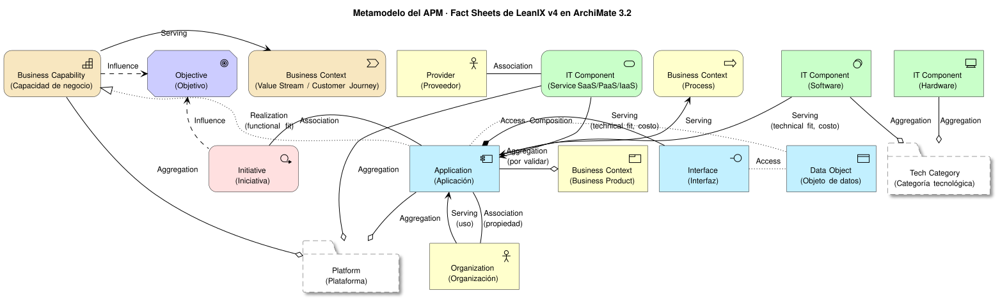
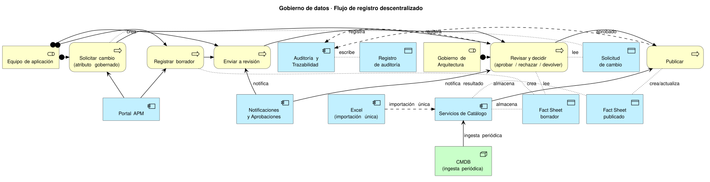
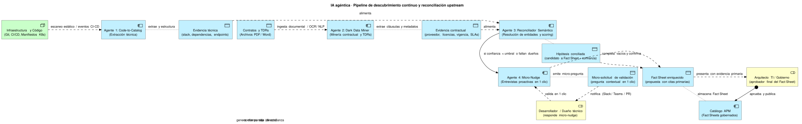
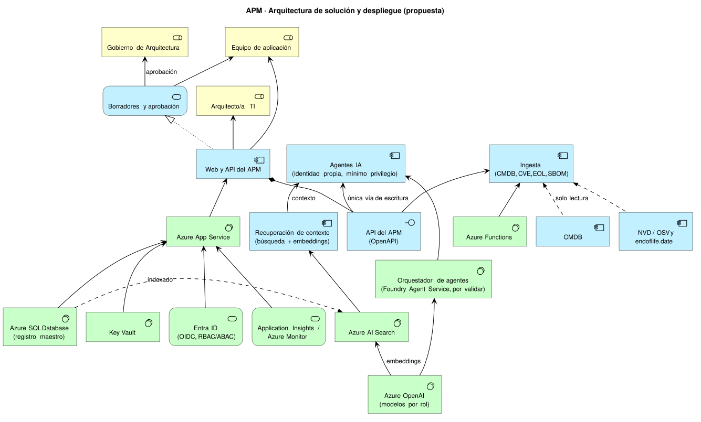
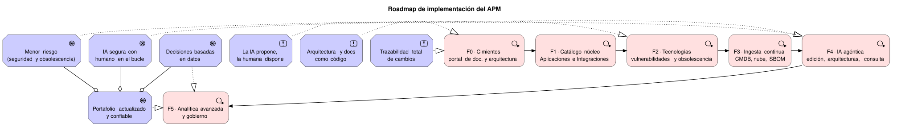
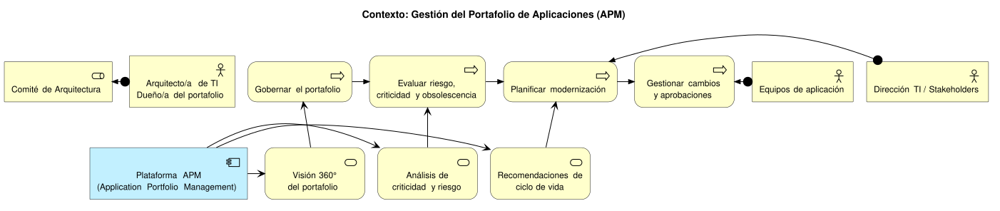
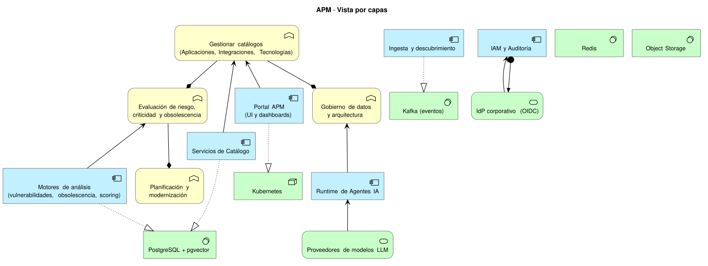
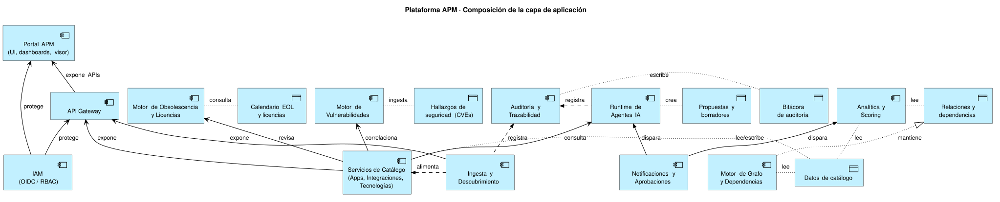
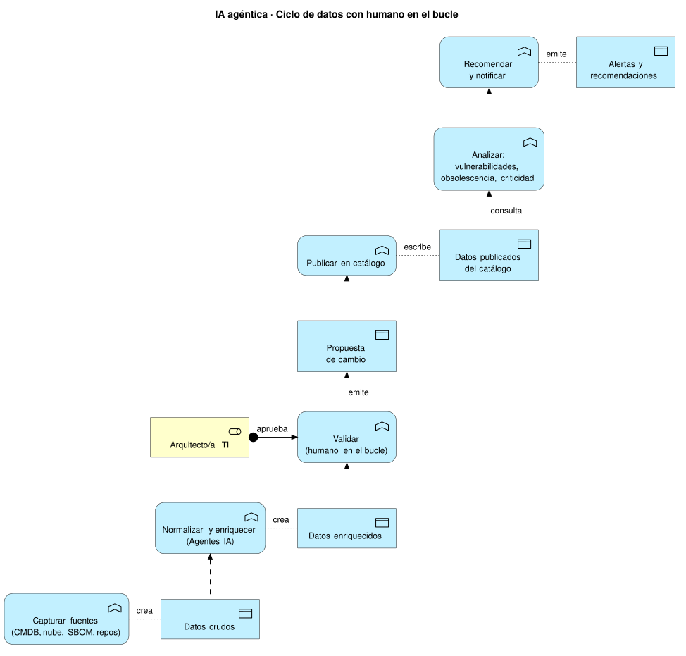

<nav class="apm-bento-marco not-content" aria-label="Secciones de la arquitectura">

<a class="apm-tile apm-tile--ruta apm-span-2" href="./catalogos/" style="--i: 0; --tono-h: 230">

Catálogos
Los catálogos que estructuran los datos del portafolio de aplicaciones.

</a>
<a class="apm-tile apm-tile--ruta apm-span-4" href="./modelo-datos/" style="--i: 1; --tono-h: 255">

Modelo de datos
Metamodelo conceptual del APM, basado en SAP LeanIX Meta Model v4 y expresado en ArchiMate 3.2.

</a>
<a class="apm-tile apm-tile--ruta apm-span-3" href="./gobierno-datos/" style="--i: 2; --tono-h: 160">

Gobierno de datos
Fuentes autoritativas, procedencia por atributo y flujo de registro descentralizado con aprobación de Gobierno de Arquitectura.

</a>
<a class="apm-tile apm-tile--ruta apm-span-3" href="./ia-agentes/" style="--i: 3; --tono-h: 275">

IA agéntica
Capacidades de IA agéntica del APM, pipeline multi-agente de descubrimiento continuo upstream y gobernanza OCDE.

</a>
<a class="apm-tile apm-tile--ruta apm-span-4" href="./arquitectura-solucion/" style="--i: 4; --tono-h: 200">

Arquitectura de solución
Propuesta de despliegue del APM en Azure, capa de IA agéntica, recuperación de contexto, ingesta y operación segura.

</a>
<a class="apm-tile apm-tile--ruta apm-span-2" href="./interfaz/" style="--i: 5; --tono-h: 310">

Interfaz (UI/UX)
Pantallas, navegación y patrones de interacción propuestos para el APM.

</a>
<a class="apm-tile apm-tile--ruta apm-span-3" href="./roadmap/" style="--i: 6; --tono-h: 65">

Roadmap
Fases de construcción del APM, de los cimientos al gobierno avanzado.

</a>
<a class="apm-tile apm-tile--ruta apm-span-3" href="./soluciones-similares/" style="--i: 7; --tono-h: 355">

Soluciones similares
Panorama de herramientas de APM y arquitectura empresarial, con y sin IA, y evaluación crítica de la propuesta frente a ellas.

</a>

</nav>

## Visión general

El APM es un sistema para que el equipo de **Arquitectura TI** gobierne el portafolio de aplicaciones con ayuda de **IA agéntica**. La arquitectura se modela en **ArchiMate 3.2** y se governa como código (PlantUML): los diagramas se revisan en *pull request*, se versionan y se publican automáticamente en este portal con cada despliegue.

Los diagramas fuente viven en `docs/arquitectura/diagramas/*.puml` y se regeneran con `npm run diagrams` (ver [guía de diagramas](../guias/diagramas/)).

## Contexto de negocio

El sistema sirve a arquitectos, equipos de aplicación y dirección: mantiene el portafolio gobernado y actualizado, evalúa riesgo y obsolescencia, y soporta la planificación de modernización con aprobaciones formales.

## Vista por capas

La solución se organiza en negocio, aplicación y tecnología. La capa de aplicación contiene los catálogos, los motores de análisis y el runtime de agentes IA; la capa de tecnología provee la plataforma de datos, event-driven y los modelos LLM.

## Composición de la plataforma

Doce componentes de aplicación y sus objetos de datos: catálogos y grafos de dependencias, ingesta, agentes IA, motores de vulnerabilidades y obsolescencia, analítica, notificaciones, IAM y auditoría.

## Ciclo de datos con IA agéntica

Todo dato que toca la IA sigue un ciclo con **humano en el bucle**: captura → enriquecimiento por agentes → validación → publicación → análisis → recomendaciones. Cada paso queda auditado.

La captura no depende solo de la carga manual: un pipeline multi-agente descubre aplicaciones en repositorios, despliegues y contratos, concilia esa evidencia con el catálogo existente (Excel migrado y CMDB) y pregunta a los responsables solo lo que no puede resolver con reglas. Los detalles están en [IA agéntica y funcionalidades](./ia-agentes/).

## Roadmap

Páginas relacionadas:

- [Catálogos del portafolio](./catalogos/)
- [Modelo de datos (metamodelo)](./modelo-datos/)
- [Gobierno y procedencia de datos](./gobierno-datos/)
- [IA agéntica y funcionalidades](./ia-agentes/)
- [Arquitectura de solución y despliegue](./arquitectura-solucion/)
- [Interfaz de usuario (UI/UX)](./interfaz/)
- [Roadmap de implementación](./roadmap/)